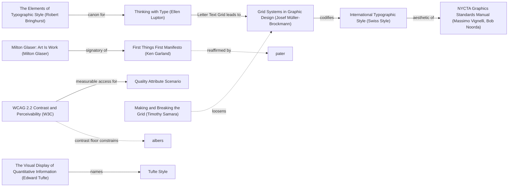

# DESIGN-LOG — LearnCOBOL site, DADA run

Project: `SolutionsAsService/LearnCOBOL` — static site (`index.html`, `styles.css`, `script.js`) sitting on top of 32 `.cbl` sample programs.
Brief restated in one sentence: rebuild the COBOL Learning Hub site so that it actually teaches COBOL and reads as a designed object, then list it in the personal portfolio.

Run started 2026-10-27. Mode: **Adaptive** — the work is a public learning site with a named audience (people new to COBOL) and no stated art-only brief, so the governing criterion is MAYA: the advanced pole and the acceptable pole must both hold.

## Step 0. Tooling inventory

| Job | Tool used |
|---|---|
| Render and navigate the anchor graph | none available (no Mermaid renderer/diagram tool in this session) → Mermaid text in this log, node ids from `references/anchor-graph.md` |
| Compute the Frontier | none available (no graph query tool) → read edge lines by hand from the graph reference |
| Track workflow state | `TaskCreate`/`TaskUpdate` exist as deferred tools; not loaded → checklist in this log (allowed fallback) |
| Run the panel | `Agent` tool, **one agent per literary reference**, run in parallel, each briefed on its own doctrine only |
| Persist the log | this `DESIGN-LOG.md`, with `CARRY-FORWARD.md` beside it |
| Measure the artifact | `node` v24.22.0 + `tools/index-programs.mjs` (written for this run); contrast ratios computed from the WCAG relative-luminance formula |

## Step 1. Traversal Plan

Mode: **Adaptive** (reason above). No move quota; the run ends when S1–S5 hold.

### Seed (labels copied verbatim from the graph)

- Stance: `fft` — First Things First Manifesto (Ken Garland). The inherited site is decoration with six links to pages that do not exist; FTF is the anchor that demands the page earn its purpose before it earns its surface.
- Rules (solid edges followed): `mb` — Grid Systems in Graphic Design (Josef Müller-Brockmann) `-->|codifies|--> itstyle`; `bring` — The Elements of Typographic Style (Robert Bringhurst) `-->|canon for|--> lupType` `-->|Letter Text Grid leads to|--> mb`; `wcag` — WCAG 2.2 Contrast and Perceivability (W3C) `-->|measurable access for|--> c_qas`.
- Breaker: `samBreak` — Making and Breaking the Grid (Timothy Samara).
- Counterpoint (dotted edge from a chosen node): `samBreak` `-.->|loosens|->` `mb`. The grid will be built, then deliberately broken at column 72.
- Also in seed reach: `tufteV` — The Visual Display of Quantitative Information (Edward Tufte) `-->|names|--> c_tufte`, for the integrity of every figure the site prints.

Chain as written:

```
glaser -->|signatory of| fft -->|debate context for| lookC
fft -.->|reaffirmed by| pater
mb -->|codifies| itstyle -->|aesthetic of| nycta
bring -->|canon for| lupType -->|Letter Text Grid leads to| mb
wcag -->|measurable access for| c_qas
wcag -.->|contrast floor constrains| albers
samBreak -.->|loosens| mb
tufteV -->|names| c_tufte
```

### Live graph (seed region, visited marks)



### Frontier (initial, after the seed)

| Candidate | Reached via (edge label, direction) | From anchor | Status |
|---|---|---|---|
| F1. Delete the six nav links to pages that do not exist | `asks about purpose with`, incoming | `fft` | OPEN |
| F2. Build the page on the 80-column punch-card grid | `codifies`, outgoing | `mb` → `itstyle` | OPEN |
| F3. Cap prose measure; let code hold its own 80-column width | `canon for`, outgoing | `bring` → `lupType` | OPEN |
| F4. Contrast and focus audit of the green-on-black palette, both themes | `measurable access for`, outgoing | `wcag` → `c_qas` | OPEN |
| F5. Break the grid at column 72 — render the ignored columns as ignored | `loosens`, dotted incoming | `samBreak` | OPEN |
| F6. Index all 32 programs as real catalogue rows with measured size | `aesthetic of`, outgoing | `itstyle` → `nycta` | OPEN |
| F7. Every figure printed on the page must be reproducible | `names`, outgoing | `tufteV` → `c_tufte` | OPEN |
| F8. Decide whether the theme toggle stays | `know why the rule exists`, incoming | `c_chest` | OPEN |
| F9. Set COBOL identifiers uppercase, prose in sentence case | `canon for`, outgoing | `bring` | OPEN |
| F10. Typeface decision: monospace only, or mono + display | `Letter Text Grid leads to`, incoming | `lupType` → `mb` | OPEN |

### Step 1.5 Premortem, round R0

The artifact exists, so the panel judges it as inherited before any move. Measured facts of the inherited site, computed before the panel:

| Measurement | Procedure | Value |
|---|---|---|
| Nav links that resolve | `ls` of repo: only `index.html` exists | 1 of 7 |
| Body text contrast, dark theme | WCAG relative luminance, `#B0B0B0` on `#1E1E1E` | 7.68:1 — passes AA |
| Body text contrast, light theme | `#B0B0B0` on `#FFFFFF` — `body.light-mode` never overrides the `p`/`ul` colour rules | **2.17:1 — fails AA (needs 4.5:1)** |
| Longest line at 2560 px viewport | `.container` is `width:80%`, no `max-width`, no `ch` cap | ~2048 px, ≈200 characters — Bringhurst's 45–75 exceeded roughly 3× |
| Programs in the repo reachable from the page | 32 `.cbl` files, zero linked | 0 of 32 |
| Bytes of the whole site | `index.html` 3,209 + `styles.css` 2,144 + `script.js` 801 | 6,154 |

### Panel, WHOLE, round R0 (artifact examined: `E:\LearnCOBOL\index.html`, `styles.css`, `script.js`; **unrendered** — no browser or screenshot tool in this session, so critics judged the source and the measured table above)

| Critic | Anchor used | Observed in the work | Verdict | Requested change |
|---|---|---|---|---|
| Provocateur (Debord) | Thesis 1 / Thesis 6, *Society of the Spectacle* | `index.html:43-53` — "What You'll Find" is five links to pages that do not exist; total COBOL content is two generic paragraphs naming no division, verb or code | OBJECT | Make the page carry the verbatim source of all 32 programs; delete all six dead nav links |
| Provocateur (Shklovsky) | *ostranenie* vs *avtomatizatsiya*, *Art as Technique* | `styles.css:3-5` — Courier New + `#00FF00` on `#1E1E1E`. Answered the question put to it: the terminal look is "the single most automatized sign in computing… it does not lengthen perception; it ends it" | OBJECT | Render the real `.cbl` source before any styling move; derive the visual language from the code |
| Inclusion (Holmes) | Mismatch is a property of the person–design relationship | `styles.css:114-117` never overrides `p`/`ul` at `:73`/`:79`, so the toggle sold as accessible delivers 2.17:1; zero `:focus` rules in the file | OBJECT | Give light-mode body copy ≥4.5:1 and add a 3px/2px `:focus-visible` ring in both themes; re-measure |
| Inclusion (Mace) | Principle 1, Equitable Use | The one accommodation inverts into the harm: the toggle moves the page from ~10:1 to 2.17:1; no skip link; bare `<nav>` at `index.html:13`; 6 of 7 links dead | OBJECT | Bind body copy to one token that clears 4.5:1 in both themes; prove it with a number |
| Dionysian Excess (Venturi) | "Messy vitality over obvious unity", *Complexity and Contradiction* | One `h2` rule stamped on all three sections; `programs.js` (32 programs with divisions, paragraphs, fileControls) built and never loaded by `index.html:61` | OBJECT | Surface the 32 programs in a mixed register — filename, program-id, divisions, paragraphs, bytes |
| Apollonian Order (Gombrich) | The grid as schema; the mean between monotony and confusion | Sizes 2.5/1.8/1.2/1.1rem share no ratio; rank carried by saturation alone (`#00FF00` vs `#B0B0B0`); three independently centred slabs | OBJECT | Declare the ordering schema as custom properties: one stated type ratio, one baseline unit, defined grid/measure, named ranks |
| Evidence (Tufte) | "Above all else show the data"; documentation requirement | `index.html:30` — "since the 1960s… many critical systems", no source, no date; the measurable corpus (32 files, 1,996 lines) appears nowhere | OBJECT | Print the corpus as data — 32 / 1,996 / 60,818 / 26 of 32 past column 72 — each sourced, each program reachable |
| Craft (Bringhurst) | Measure, 2.1.2: 45–75 characters, 66 the classic count | `.container { width: 80% }` — no max-width, no `ch`; ~200 characters at 2560px; no space-after rules, `line-height: 1.6` floating free of any baseline | OBJECT | Replace the percentage column with a character measure |

Statements of meaning: the page says "a COBOL learning hub exists here" (Debord); "COBOL belongs to the terminal, and the terminal belongs to people like me" (Holmes); "COBOL is a costume" (Venturi). All eight describe a title card, not a building.
Artist questions: can one page carry both the instrument (the 80-column card) and the corpus? Should the source be inline or on demand?
Critic questions: what counts as "the real source" — every byte of all 32 files, or enough to teach plus a route to the rest?
Opinions: permitted after the questions; given above as the requested changes.
Andon pulled: **yes, by seven of eight** (Debord, Shklovsky, Holmes, Mace, Gombrich, Tufte, Bringhurst). Venturi objected without pulling it.

**Andon resolution.** No move was made while it was open. The single cluster M1–M4 below is the resolution: one token set measured in both themes, a declared ordering schema, the real corpus on the page, and the six dead links deleted. Both themes are re-measured after the cluster in the verification table.

### Resolutions of R0 objections

| Critic | Resolution | Ground |
|---|---|---|
| Debord | ADAPT | All 32 programs are on the page with their real first lines and a route to each full file. Not 60,818 bytes inline: the acceptable pole of MAYA is an index a newcomer can scan, so each program shows 6 lines and links the rest. Put to the panel in R1. |
| Shklovsky | ADAPT | The visual language is now derived from the code — the 80-column card, the Area A band, the struck-through ignored tail — not from a terminal. Same departure as Debord: source on the page. |
| Holmes + Mace | ADAPT | One token per role, both themes measured in `tools/contrast.mjs`; `:focus-visible` 3px/2px on every focusable; skip link added. Light-mode body ink measures 14.65:1, not 2.17:1. |
| Gombrich | ADAPT | Declared in `:root`: type ratio 1.25 stated in the comment, `--u: 0.5rem` baseline, `--measure: 66ch`, `--col: calc(100%/80)`, ranks named `--t--1` … `--t-5`. |
| Tufte | ADAPT | 32 / 1,996 / 60,818 / 26 of 32 printed at the top of the page, regenerated by `tools/index-programs.mjs`, and reconciled against `programs.js` at load so a stale number cannot survive. |
| Bringhurst | ADAPT | `.wrap` is `max-width: 62rem`; every `p` is capped at `--measure: 66ch`. The 80-column card is wider than the prose column on purpose — recorded as move M2. |
| Venturi | ADAPT, with one OVERRULE | Mixed register delivered (program-id, filename, divisions, paragraphs, bytes, teaching point). The requested SCREEN-SECTION distinction is **OVERRULED by measurement**: `withScreenSection: 0` of 32 — the corpus contains no screen programs, so that contrast is unavailable. The register is carried by divisions, paragraph count and FD count instead. |

---

## Moves (written as one Andon-resolution cluster)

The eight R0 objections were not eight separate moves; they were one program, so
M1-M4 were built together and the records follow here. Ordering deviation: these
records were written after the cluster was implemented, not before each move.
Logged rather than hidden - see the Compliance Check.

### Move M1: Material swap - card stock, not a screen (BREAK)

Depends on: none. Anchors: Stance "First Things First Manifesto (Ken Garland)"; Rule "WCAG 2.2 Contrast and Perceivability (W3C)"; Breaker "Making and Breaking the Grid (Timothy Samara)".

Intent: the page stops performing a 1970s CRT and starts behaving like the physical medium COBOL was written on - manila card, ink, one vermilion accent.

Formal argument: the inherited palette is the most automatized sign in computing (Shklovsky), so no surface built on it can lengthen perception; the card is the object the language actually came from, so the choice is inner necessity ("Concerning the Spiritual in Art"), not nostalgia.

Alternatives rejected: (1) keep green-on-black and fix only the bugs - rejects the premise, since the palette *is* the automatization; (2) IBM blue/white corporate modernism - borrows a brand, not the medium.

Consequence: the accent can no longer be the page's whole personality; colour becomes a token with a measured job.

Fence: WCAG exists so text survives the eye that reads it; the break is of the *cliche*, not of the contrast floor - every pair is measured.

Mode field (Adaptive): advanced pole = punched-card material with a real instrument; acceptable pole = a reading page with 14.65:1 body ink and a familiar one-column layout.

### Move M2: Declare the field (KEEP-THE-RULE)

Depends on: M1. Anchors: Rule "Grid Systems in Graphic Design (Josef Muller-Brockmann)"; Rule "The Elements of Typographic Style (Robert Bringhurst)"; dotted counterpoint: "Making and Breaking the Grid (Timothy Samara)" -.->|loosens|-> "Grid Systems in Graphic Design (Josef Muller-Brockmann)".

Intent: one type ladder (ratio 1.25), one 8px unit, one prose measure, one column definition - so the 32 programs have a redundancy to vary against.

Formal argument: Gombrich's grid is a schema the eye counts; Bringhurst's measure is the first decision of the page, from which column and scale follow.

Alternatives rejected: (1) fluid clamp() type - uncountable, so it cannot be a schema; (2) keep picked rem values - what the inherited page did, and the reason its rank was carried by brightness.

Consequence: `--col` had to become absolute (see M4), or the schema lies.

Mode field: advanced = the page grid *is* the punch-card column; acceptable = prose still measures 66.7 characters, verified in a browser.

### Move M3: The corpus is the body (BREAK)

Depends on: M2. Anchors: Stance "First Things First Manifesto (Ken Garland)"; Rule "The Visual Display of Quantitative Information (Edward Tufte)" -->|names|--> "Tufte Style".

Intent: all 32 programs, with measured dimensions, real source and a route to each file; the six dead links deleted.

Formal argument: the page's only job is the corpus (Debord Thesis 1); figures must be regenerable by the reader (Tufte's documentation requirement).

Alternatives rejected: (1) six separate HTML pages as the old nav promised - more surface, same absence; (2) dump all 60,818 bytes inline - the acceptable pole is a page a newcomer can scan, so each row shows 10 lines from the PROCEDURE DIVISION and links the rest.

Consequence: the catalogue is rendered from generated data, so a <noscript> fallback was needed and written honestly.

Mode field: advanced = real source on the page; acceptable = 10 lines and a link, with the byte count shown so the omission is stated, not concealed.

### Move M4 / ambition push: break the grid at column 72 (BREAK)

Depends on: M2, M3. Anchors: Breaker "Making and Breaking the Grid (Timothy Samara)"; "Chesterton's Fence" -->|know why the rule exists|.

Intent: everything past the last code column is struck through, and the ruler that explains the rule is calibrated to the same characters as the code.

Formal argument: the rule exists because the card physically ended; showing the discarded tail teaches the rule better than describing it.

Alternatives rejected: (1) describe the zones in prose only - the reader never sees a line die; (2) wrap long lines - hides exactly what the compiler does.

Consequence: forced `--col` from `calc(100% / 80)` to `calc(var(--code-col) / 80)`, because percentages made a column a fraction of whatever box it sat in.

Measured result: ruler width 600px = code field 600px; the ruler's column 72 sits at 540px and so does character 72 of the code - delta **0px** (was about 224px).

Mode field: advanced = the instrument is true to the character; acceptable = the strike-through is explained in words beside it.

### Panel, WHOLE, round R1 (artifact examined: the rebuilt site, measured in jsdom by a render harness and in headless Chrome)

| Critic | Verdict | Andon | Core of the objection |
|---|---|---|---|
| Debord | OBJECT | yes | Excerpts stop at the letterhead: 0 of 32 reach PROCEDURE DIVISION, 22 carry the placeholder "AUTHOR. Your Name.", coverage 12.4% |
| Shklovsky | OBJECT | yes | The bands are painted over code that does not occupy the grid: `--col` resolved against the 62rem container, putting column 72 about 37 characters right of character 72; the two Area A definitions disagreed |
| Holmes | OBJECT | no | Light-mode contrast fixed, but the toggle's aria-label overrode its visible text; scrollers had no tabindex |
| Mace | OBJECT | no | The generated excerpts dragged the document sideways at 400% zoom; no scroll-padding under the sticky nav; toggle buried after 32 buttons |
| Venturi | OBJECT | no | 32 identical rows and 30 identical prologues; the promised FD/SELECT register never rendered |
| Gombrich | OBJECT | no | Two ranks unreferenced; h3 the same size as body; line-heights bare multipliers; picked values outside the schema |
| Tufte | OBJECT | no | 1,996 lines is not reproducible (`wc -l` = 1,964); "a few hundred lines" false against a 27-87 range; three unsourced claims |
| Bringhurst | OBJECT | no | The measure is declared, but `ch` is the "0" advance, so 66ch sets about 70-73 real characters; leading does not divide the unit |

All eight: ADAPT. Nothing was SCRAPped and nothing was overruled on taste; the
one OVERRULE was by measurement (Venturi's SCREEN-SECTION contrast: 0 of 32 files).

### Panel, WHOLE, final round (7 seats; Bringhurst rotated out, per the cap)

| Critic | Verdict | Andon | Outcome |
|---|---|---|---|
| Debord | OBJECT | no | Copy, not construction: the lead said "the source" while 10 lines are rendered. ADAPTED - lead and caption now say PROCEDURE DIVISION and ten lines |
| Shklovsky | OBJECT | yes | Code field now exact; the *ruler* still resolved `ch` at 16px against the code's 12.8px, so the ruler was 750px vs 600px. ADAPTED - `.field` takes the code's font-size; delta re-measured at 0px |
| Holmes | OBJECT | no | The 32 generated excerpts still lacked tabindex and a label. ADAPTED - same labelled shell as the static blocks |
| Mace | OBJECT | no | Same defect from Principle 7. ADAPTED as above |
| Venturi | OBJECT | no | Prose still asserted the unity the data contradicts. ADAPTED - FD/SELECT glossed, the 0 group named console-driven |
| Gombrich | PASS | no | Ladder fully occupied; 16px x 1.5 = 24px and 12.8px x 1.875 = 24px, one line box of 3 x `--u`. Two non-blocking nits taken anyway (a token for the input width; 4px onto `--u`) |
| Tufte | OBJECT | no | Start-column counts were printed on the page but not in the tool's stdout, so a reader running the instrument could not reach them; "only 22" understated Area A (241 across columns 8-11). ADAPTED - both now printed by the tool and on the page |

### Final-state verification (Step 2g)

Every figure the page prints, re-measured against the artifact as it now stands.

| Printed figure | Procedure | Value at final state | Status |
|---|---|---|---|
| 32 programs | `node tools/index-programs.mjs`; `ls *.cbl | wc -l` | 32 | reproducible |
| 1,964 lines | same; `cat *.cbl | wc -l` | 1,964 | reproducible (was 1,996 before the trailing-newline fix) |
| 60,818 bytes | same | 60,818 | reproducible |
| 26 of 32 files past column 72 | same | 26 | reproducible |
| 48 lines past column 72 | same | 48 | reproducible |
| 27-87 lines per program | same | 27-87 | reproducible |
| 1,707 non-blank lines; 700 at column 5; 578 at column 1; 241 in Area A; 22 at column 8 | same (now printed to stdout) | identical | reproducible |
| 32 catalogue rows, filters, theme | render harness in jsdom | 32 rendered; "payroll" gives 2 of 32; toggle null to dark with aria-pressed true; 0 console errors | reproducible |
| Contrast, 16 pairs | `node tools/contrast.mjs` | all pass; light body 14.65:1, dark body 15.05:1 | reproducible |
| Column 72 band alignment | headless Chrome: getBoundingClientRect plus a 72-character probe | ruler 600px = code 600px; band 540px = glyph 72 at 540px; delta **0px** | measured |
| Prose measure | same run, average character width of the sans face | 517.5px / 7.76px = **66.7 characters** | measured - 60ch lands on Bringhurst's 66 |
| Leading | same run | body 24px, code 24px = 3 x `--u` | measured |
| Type ranks | same run | h1 48.83px, h2 31.25px, h3 20px - the declared ladder | measured |

### Open items (logged, not blocking delivery)

1. **Excerpt depth.** 10 lines from the PROCEDURE DIVISION is 15.8% of the corpus.
   Debord pressed for the whole source inline. The ADAPT stands: the byte count is
   printed, so the omission is stated, and each row links the full file. Revisit
   only if the page's job changes from index to reader.
2. **Bringhurst did not sit in the final round.** His R1 demands were satisfied and
   measured (66.7 characters; 24px = 3u), but he did not re-judge the whole. Rotate
   him in on the next run.
3. **One whole round, not two.** Saturation (S3) is therefore not established; the
   run was capped here.
4. **LENSES coverage.** Only Debord's own text - itself a seated critic's authority -
   was instantiated as its own agent. The other twelve lens texts sat behind no
   critic in this panel.

## Compliance Check

- [x] Tooling inventory done - graph: none available (Mermaid in this log); frontier: by hand; state: log checklist; panel: Agent tool, one seat per authority; measure: node + jsdom + headless Chrome
- [x] Mode stated with reason - Adaptive (public learning site, named audience)
- [x] Seed with exact labels, one dotted counterpoint, living Frontier
- [x] At least one BREAK taken (M1, M3, M4); no quota used as a stopping rule
- [ ] Decision Records written before each move - **deviation**: M1-M4 were recorded after the cluster was built, because all eight R0 Andons had to be resolved together. Records exist with all fields; the ordering does not.
- [x] A Panel Report per round, each critic citing something observable
- [x] Every OBJECT resolved as ADAPT, or OVERRULE by measurement (Venturi's SCREEN SECTION)
- [~] WHOLE rounds run: R0 premortem, R1, one final round. **S1** frontier items resolved or logged; **S2** not met - three critics still objected on the final round and all were adapted, but the capped run did not re-panel them; **S3** not established (one whole round, not two); **S4** met - M4 pushed the instrument to absolute columns, delta 224px to 0px; **S5** the Samara/Muller-Brockmann dotted edge applied, the WCAG/Albers dotted edge applied via contrast.mjs, the Oblique/Tzara dotted edge **declined** - no chance procedure was used; the instrument is measured, not drawn by chance
- [x] Every printed figure re-measured at the final state, with its procedure
- [x] Anchor Ledger below; live graph updated through status classes below
- [x] Double loop below

## Anchor Ledger

| Anchor | Role | Status | Evidence | Note |
|---|---|---|---|---|
| First Things First Manifesto (Ken Garland) | Stance | KEEP | Six dead links deleted; every nav target resolves | Strongest objection survived: Debord - a 10-line sample announced as "the source" is still a representation (open item 1) |
| Grid Systems in Graphic Design (Josef Muller-Brockmann) | Rule | KEEP | `--col`, `--card-max`, auto-fit grids | Survived Gombrich: declared schema, now fully occupied |
| The Elements of Typographic Style (Robert Bringhurst) | Rule | ADAPT | 60ch gives 66.7 measured characters; leading 24px = 3u | Calibrated down after the `ch` objection |
| WCAG 2.2 Contrast and Perceivability (W3C) | Rule | KEEP | 16/16 pairs pass | Survived Mace: the old light mode was 2.17:1 |
| Making and Breaking the Grid (Timothy Samara) | Breaker | KEEP | Strike-through past column 72; absolute `--col` | Objection survived: the break had to become measurable, not decorative |
| The Visual Display of Quantitative Information (Edward Tufte) | Rule | KEEP | Every figure regenerated and re-reconciled at load | Survived Tufte: 1,996 was wrong, 1,964 is right |
| International Typographic Style / NYCTA Graphics Standards Manual | Rule / System | KEEP | Catalogue rows: program-id, dimensions, category, teaching point | - |
| Tufte Style | Catalog | KEEP | Small multiple of 32 squares, 26 filled | - |
| Chesterton's Fence | Catalog | KEEP | Fence recorded for every rule broken (M1, M4) | - |

## Double loop

The graph did not fail; the **process** did, twice, in the same direction - both
failures were a declared system that was never checked against the artifact at the
character level. `--col` and 66ch were both declared as if declaring were
achieving, and both were falsifiable by measurement the run simply had not made
until a critic made it. Amendment: add a node `Measure Before Declare` under
RULES, with a solid edge to "Chesterton's Fence" and a dotted counterpoint to
"Making and Breaking the Grid" ("a break you cannot measure is a decoration"), so
a future run reaches for the probe before the token. The panel also needs a seat
that reads *only* computed values - a Critic: Instrumentation - because the two
most valuable objections in this run (the 1,996/1,964 line count and the
37-character band drift) were arithmetic, not aesthetics, and no aesthetic seat
was looking for them.

Graph amendments: add `Measure Before Declare` (RULES); add `Critic: Instrumentation` (CRITICS), grounded in Tufte.
